<div align="center">

<picture>
  <source media="(prefers-color-scheme: dark)" srcset="./dark.svg">
  <source media="(prefers-color-scheme: light)" srcset="./light.svg">
  
</picture>

<br/>

[](https://github.com/anshuguleria10th-wq)
[](https://www.linkedin.com/in/anshuman-guleria-75870a381)
[](mailto:anshuguleria10th@gmail.com)

</div>

---

### ⚡ Terminal Overview

```bash
anshuguleria10th-wq@system:~$ ./profile --summary
```

```yaml
Name: Anshuman Guleria
Location: Greater Noida, India
Status: 3rd Semester Software Engineering Student @ NxtWave
Discipline: Backend Software Engineering · Web Development · Game Systems
Core Stacks: C++, MERN (MongoDB, Express.js, React, Node.js), Godot 4.3
Interests: Systems Programming, 3D Game Loops, LLM RAG Pipelines & Vector Databases
```

---

### 🛠️ Engineering & Technology Stack

<table>
  <tr>
    <td width="25%" valign="top"><strong>Languages</strong></td>
    <td>
      <code>C++</code> · <code>JavaScript</code> · <code>GDScript</code> · <code>Python</code>
    </td>
  </tr>
  <tr>
    <td width="25%" valign="top"><strong>Backend &amp; Web</strong></td>
    <td>
      <code>Node.js</code> · <code>Express.js</code> · <code>Mongoose</code> · <code>REST APIs</code>
    </td>
  </tr>
  <tr>
    <td width="25%" valign="top"><strong>Game Engines &amp; 3D</strong></td>
    <td>
      <code>Godot 4.3</code> · <code>3D Game Loops</code> · <code>Interactive Web 3D</code>
    </td>
  </tr>
  <tr>
    <td width="25%" valign="top"><strong>Databases &amp; AI Tools</strong></td>
    <td>
      <code>MongoDB</code> · <code>SQLite</code> · <code>ChromaDB</code> · <code>LangChain</code> · <code>Gradio</code> · <code>HuggingFace</code>
    </td>
  </tr>
  <tr>
    <td width="25%" valign="top"><strong>VCS &amp; Workflow</strong></td>
    <td>
      <code>Git</code> · <code>GitHub</code> · <code>Vercel</code>
    </td>
  </tr>
</table>

---

### 🚀 Featured Project

#### 🏋️ **[FitBharatApp](https://fit-bharat-app.vercel.app/)** — *MERN Stack Fitness Web Platform*
- **Live Deployment:** [fit-bharat-app.vercel.app](https://fit-bharat-app.vercel.app/)
- **Core Architecture:** Built with the MERN stack (MongoDB, Express.js, React, Node.js).
- **Key Capabilities:**
  - Custom workout splits tailored for students and beginners.
  - High-protein meal calculation and macro tracking logic.
  - Interactive 3D visual UI components for enhanced user engagement.
  - Fast, responsive design deployed on Vercel with modern state handling.

---

### 📊 GitHub Activity & Telemetry

<div align="center">
  
  
</div>

---

### 📬 Connect & Collaborate

- **GitHub:** [@anshuguleria10th-wq](https://github.com/anshuguleria10th-wq)
- **LinkedIn:** [Anshuman Guleria](https://www.linkedin.com/in/anshuman-guleria-75870a381)
- **Email:** [anshuguleria10th@gmail.com](mailto:anshuguleria10th@gmail.com)
- **Status:** Open to backend engineering, game development, and full-stack internships & collaborations.
